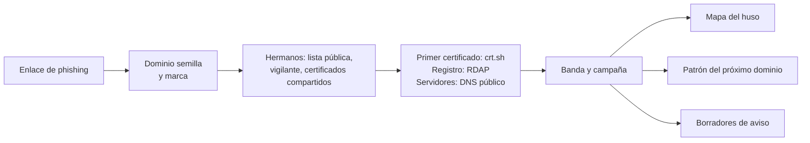

# Rastro

[](https://github.com/Ruby570bocadito/rastro/actions/workflows/tests.yml)
[](https://github.com/Ruby570bocadito/rastro/blob/main/pyproject.toml)
[](https://github.com/Ruby570bocadito/rastro/blob/main/LICENSE)

**Pega un enlace de phishing. Mira cómo se despliega la campaña entera.**

[English](https://github.com/Ruby570bocadito/rastro/blob/main/README.md) · Español


Un SMS de phishing es un enlace. Detrás suele haber una banda que ha registrado decenas de dominios con la misma plantilla, lanzamiento tras lanzamiento, y que mañana registrará el siguiente. Rastro parte de ese único enlace y te da, en un expediente que no depende de nada más:

- **la banda y la campaña**: todos los dominios construidos con la misma plantilla de nombres, y los que se unen a tu enlace por pistas que suman (un certificado compartido, el mismo servidor, la misma sesión de trabajo);
- **dónde trabaja la banda**: el huso horario de su jornada, leído de los momentos en que registró dominios y pidió certificados, con un «no concluyente» honesto cuando no hay datos suficientes;
- **su próximo dominio**: un patrón estrecho que vigilar en Certificate Transparency y que caza el siguiente dominio falso en cuanto recibe su certificado;
- **a quién avisar**: un borrador de aviso de abuso por registrador, o por plataforma de hosting para los sitios en subdominios gratuitos, para los dominios que siguen activos.

Husmo, un hurón detective, explica cada deducción y cuánta seguridad tiene. Rastro nunca se conecta a los dominios, nunca busca a las personas que hay detrás y nunca envía nada por ti.

> Estado: 0.2, temprano. Cada pieza se validó antes con datos reales, pero habrá asperezas.

## Pruébalo en 30 segundos

**[Abre el expediente de la demo](https://ruby570bocadito.github.io/rastro/es/)** en tu navegador, sin instalar nada ([in English](https://ruby570bocadito.github.io/rastro/)). Para ejecutarlo tú necesitas Python 3.11 o superior, sin dependencias.

```bash
pipx install git+https://github.com/Ruby570bocadito/rastro
```

```bash
rastro demo --open --lang es
```

También vale `pip install git+https://github.com/Ruby570bocadito/rastro`, y cada [versión publicada](https://github.com/Ruby570bocadito/rastro/releases) trae un wheel que puedes instalar con `pipx install` sobre el archivo descargado.

La demo es un caso inventado. Sus marcas no existen, sus dominios acaban en `.test` (reservado, así que nadie puede registrar uno), sus direcciones son de los rangos reservados para documentación y su banda está simulada en UTC+3, de lunes a viernes. El expediente marca esa verdad bajo el mapa, para que compares la respuesta de Rastro con la realidad.


Pulsa **Escuchar a Husmo** y el hurón lee en voz alta sus deducciones, una a una, moviendo la boca con calma. Solo usa voces instaladas en tu sistema: una voz en la nube mandaría el texto del caso, dominios de los atacantes incluidos, a un servicio externo, así que sin una voz sin conexión el botón queda apagado y explica por qué.


## Cómo funciona



1. **Hermanos.** Dominios parecidos construidos como la semilla (misma marca y plantilla, o la misma palabra rara) en una lista pública de phishing, en lo que guardó el vigilante y entre los nombres que compartieron certificado con ella.
2. **Perfiles.** De cada uno: su primer certificado (crt.sh), su registro y su registrador (RDAP), y sus direcciones y servidores de nombres (el DNS sobre HTTPS de Cloudflare). Contestan los registros y el resolvedor, nunca el dominio.
3. **Banda y campaña.** La banda son todos los dominios construidos con la plantilla estrecha de la semilla, a veces a lo largo de años. La campaña es el grupo de la semilla cuando se agrupan las pistas que suman:

   | Pista | Peso |
   |---|---|
   | certificado compartido | 1,0 |
   | la misma palabra larga y rara junto a la marca | 1,0 |
   | misma plantilla | 0,5 |
   | misma sesión de trabajo (30 minutos) | 0,5 |
   | mismo lanzamiento (cada dominio a menos de 72 horas del anterior) | 0,5 |
   | misma dirección o mismos servidores de nombres | según lo raros que sean |

   Las parejas que llegan a 1,0 entran en la misma campaña. Una plantilla sola nunca une dos dominios.
4. **El reloj.** Los registros y los primeros certificados son actos de la propia banda, así que siguen su jornada. Rastro los agrupa en sesiones de trabajo, puntúa los 24 husos nominales frente a una jornada típica (teniendo en cuenta los bots y las bandas que empiezan antes o después) y los contrasta con una actividad uniforme durante todo el día. Con sesiones suficientes lee también el fin de semana y el horario de verano. Por debajo de lo que los experimentos vieron necesario, cada pista responde «no concluyente».
5. **El próximo dominio.** Una expresión regular legible aprendida de los nombres de la banda. Solo se arma si es estrecha (como mucho 10^9 nombres posibles), porque las anchas daban miles de falsas alarmas al día.
6. **Los borradores.** Uno por registrador, con las pruebas, para los dominios que siguen registrados. Los caducados, suspendidos, defensivos y vueltos a registrar quedan fuera, cada uno con su motivo. Los sitios en plataformas de hosting (pages.dev, vercel.app, github.io...) van a la plataforma, con su formulario de abuso cuando Rastro lo conoce. La mayoría de plataformas responden en DNS a cualquier nombre, así que Rastro no puede distinguir un sitio activo de uno retirado sin visitarlo: su borrador lo dice, y `rastro track` no los sigue.

## Investiga un enlace real

Primero descarga la lista pública de dominios de phishing en la que Rastro busca hermanos: los dominios activos de [Phishing.Database](https://github.com/Phishing-Database/Phishing.Database), unos 10 MB, licencia MIT. Vuelve a ejecutarlo de vez en cuando: solo descarga si la lista ha cambiado.

```bash
rastro list update
```

```bash
rastro investigate "hxxps://dominio-falso[.]example/ruta" --lang es
```

Pega el enlace tal como llegó, desactivado o no. Husmo cuenta el resultado en la terminal y el caso queda en `data/raw/reports/<dominio>.html`.

El expediente lleva dentro sus datos, estilos y script, con una Content-Security-Policy que prohíbe cualquier petición de red, así que abrirlo no contacta con nadie. Nunca contiene la ruta del enlace, que suele llevar un token que identifica a quien lo recibió, y escribe todo texto controlado por los atacantes como texto, nunca como HTML.

`--list FICHERO` indica la lista de phishing en la que buscar: por defecto `data/raw/lists/phishing-domains-ACTIVE.txt` si existe, tal como la deja `rastro list update`. `--db` añade lo que guardó el vigilante, `--json FICHERO` guarda los datos del caso, `--offline` usa solo respuestas guardadas, y `--no-crtsh`, `--no-rdap` y `--no-dns` se saltan una fuente.

## Vigila Certificate Transparency

```bash
rastro watch --learn dominios-campaña.txt --follow --minutes 60 --db data/ct.sqlite --alerts alertas.jsonl --bursts-every 10
```

Rastro lee los registros de Certificate Transparency directamente, con la API estática de CT, y sigue el ritmo del registro de Let's Encrypt en tiempo real.

- Solo arma patrones estrechos y dice cuáles se salta; `--allow-broad` lo fuerza.
- No puede ver los sitios de plataformas que los sirven todos con un mismo certificado, como vercel.app, github.io o netlify.app: ningún certificado suyo llega al registro. Los sitios de pages.dev y workers.dev tienen el suyo, así que el vigilante los ve.
- Los dominios oficiales de las marcas nunca dan alerta, y `--allow FICHERO` añade los tuyos.
- Cada dominio alerta una sola vez, aunque lleguen al registro su precertificado y su certificado.
- `--bursts-every` busca, sin semilla, varios dominios nuevos de una misma marca construidos con la misma plantilla, y da el patrón listo para armar.
- Con `--db` retoma donde lo dejó y guarda solo los certificados con un dominio falso de marca o que dieron alerta: entre el 0,2 y el 0,4 % del registro, decenas de MB al día en vez de unos 6 GB. `--store-all` lo guarda todo.
- Sin `--follow` lee las últimas `--tiles` teselas y para. `rastro logs` lista los registros actuales, que cambian cada seis meses.

## Sigue las retiradas

```bash
rastro investigate "hxxps://dominio-falso[.]example/ruta" --track --lang es
```

```bash
rastro track add dominio-falso.example --reported
```

```bash
rastro track check --every 6
```

```bash
rastro track report --html data/raw/marcador.html --from-report --lang es
```

Rastro sigue los dominios vivos de una investigación (`--track`), cada dominio que hace saltar al vigilante (`rastro watch --track`) y los que añadas a mano. Cada revisión pregunta al registro (RDAP) y a un DNS público por cada dominio que sigue en pie, nunca al dominio, y anota si está vivo, sin web, suspendido, borrándose o fuera. Un dominio cae la primera vez que aparece suspendido, borrándose o fuera de su zona antes de caducar.

`--reported` apunta cuándo enviaste el aviso de abuso, y `--from-report` cronometra a cada registrador desde ese momento. El marcador es una estimación de Kaplan-Meier: un dominio que sigue en pie cuenta como en pie hasta su última revisión en vez de descartarse, así que un registrador que nunca actúa no puede parecer rápido. Se llena con el tiempo: ejecuta la revisión cada pocas horas durante un par de semanas.


## Otros comandos

| Comando | Qué hace |
|---|---|
| `rastro track add\|check\|report` | sigue los dominios después de encontrarlos y puntúa a los registradores por su rapidez |
| `rastro campaigns --domains FICHERO --dns` | agrupa dominios en campañas, desde una lista o desde lo que guardó el vigilante (`--db`) |
| `rastro bursts --db data/ct.sqlite --hours 24` | busca campañas naciendo entre los nombres que guardó el vigilante |
| `rastro pattern FICHERO` | aprende el patrón de nombres de una campaña y dice cuántos nombres podría cazar |
| `rastro rhythm FICHERO` | estima el huso de una banda a partir de horas UTC, con las pistas de fin de semana, horario de verano y festivos |

Rastro conoce unas 60 marcas, listadas en [brands.txt](https://github.com/Ruby570bocadito/rastro/blob/main/src/rastro/assets/brands.txt). `rastro --brands FICHERO <comando>` añade las tuyas, una por línea como `clave | Nombre | dominios oficiales`.

## Validado con datos reales

Cada pieza se probó con campañas reales antes de entrar en el producto. Los detalles, y lo que falló, están en [experiments](https://github.com/Ruby570bocadito/rastro/blob/main/experiments/README.md) (en inglés).

| Pregunta | Respuesta |
|---|---|
| ¿Muestran las bandas una jornada laboral en las horas de sus primeros certificados? | Sí en 3 de 4 familias de plantilla, tras corregir por comparaciones múltiples. La familia de Coinbase trabaja en torno a UTC−7 |
| ¿Caza un patrón aprendido los demás dominios de una campaña sin cazar otros? | Los patrones estrechos cazan una mediana del 87 %, sin coincidencias de fuera |
| ¿Cuántas veces saltarían con certificados nuevos? | Los estrechos: 0 de 30.720. Los anchos: unas 6.600 falsas alarmas al día, así que solo se arman los estrechos |
| ¿Se parten las familias de plantilla en campañas? | Sí: una familia era un único lanzamiento de 68 dominios, otra llegó en oleadas |
| ¿Cuántos datos necesitan las pistas de calendario? | El fin de semana, unas 50 sesiones en 8 semanas. El horario de verano, cientos |
| ¿Se despliega un enlace de principio a fin? | Un dominio falso de Coinbase cazado en vivo, que no estaba en la lista pública, se desplegó en una banda de 95 dominios. Solo él seguía activo, y el reloj volvió a dar UTC−7 |
| ¿Detecta un modelo solo con el nombre el phishing entre los certificados nuevos? | Todavía no. Con nombres del registro como benignos (07), las campañas vivas se colaron entre ellos; con nombres de más de un año comprobados por RDAP (07b), 3.600 benignos fueron pocos y llamó phishing a casi todo. No se incluye ningún modelo de nombres |
| ¿Se expande una URL a sus hermanos con urlscan? | Aún no. urlscan no había visto nunca 14 de 20 dominios de la lista, y el escaneo más reciente suele ser de la página ya caída. Con la página viva, dos semillas llegaron a 27 y 95 dominios, pero casi ninguno se pudo confirmar, así que no se incluye |

## Lo que Rastro nunca hará

- Identificar personas. Se queda en husos horarios e infraestructura.
- Conectarse a la infraestructura de los atacantes, o usar credenciales encontradas en kits de phishing.
- Enviar nada en tu nombre: los avisos de abuso son borradores.
- Publicar análisis de URL que contengan datos de víctimas.

## Hoja de ruta

- Expansión desde una URL con urlscan, para campañas que cambian de nombres pero no de página: el experimento 02 falló con semillas viejas; el siguiente intento, con semillas frescas y al menos dos archivos compartidos.
- Un modelo de nombres que merezca la pena incluir: los experimentos 07 y 07b mostraron que necesita miles de nombres benignos limpios con marca; una semana de vigilante los reúne y RDAP los ordena por edad.

## Desarrollo

```bash
git clone https://github.com/Ruby570bocadito/rastro
```

```bash
pip install -e ./rastro pytest
```

```bash
python -m pytest rastro
```

Los tests usan solo datos sintéticos: sin red y sin claves. [CONTRIBUTING.md](https://github.com/Ruby570bocadito/rastro/blob/main/CONTRIBUTING.md) explica la estructura y las reglas que respeta cada cambio.

## Seguridad

Para avisar de una vulnerabilidad en el propio Rastro, mira [SECURITY.md](https://github.com/Ruby570bocadito/rastro/blob/main/SECURITY.md).

## Licencia

[Apache-2.0](https://github.com/Ruby570bocadito/rastro/blob/main/LICENSE). Copyright 2026 Ruby570bocadito.

El contorno de tierra del mapa viene de [Natural Earth](https://www.naturalearthdata.com/) (dominio público), a través del paquete world-atlas.
