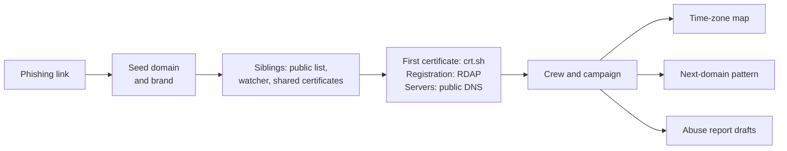

# Rastro

[](https://github.com/Ruby570bocadito/rastro/actions/workflows/tests.yml)
[](https://github.com/Ruby570bocadito/rastro/blob/main/pyproject.toml)
[](https://github.com/Ruby570bocadito/rastro/blob/main/LICENSE)

**Paste a phishing link. Watch the whole campaign unfold.**

English · [Español](https://github.com/Ruby570bocadito/rastro/blob/main/README.es.md)


A phishing SMS is one link. Behind it there is usually a crew that registered dozens of domains from the same template, launch after launch, and will register the next one tomorrow. Rastro starts from that one link and gives you, in one self-contained case file:

- **the crew and the campaign**: every domain built from the same naming template, and the ones tied to your link by clues that add up (a shared certificate, the same server, the same work session);
- **where the crew works**: the time zone of its working day, read from the moments it registered domains and asked for certificates, with an honest "inconclusive" when the data is not enough;
- **its next domain**: a narrow pattern to watch on Certificate Transparency, which catches the next lookalike the moment it gets a certificate;
- **who to warn**: one abuse report draft per registrar, or per hosting platform for sites on free subdomains, for the domains still live.

Husmo, a detective ferret, explains every deduction and how sure it is. Rastro never connects to the domains, never looks for the people behind them and never sends anything for you.

> Status: 0.2, early. Every piece was validated on real data first, but expect rough edges.

## Try it in 30 seconds

**[Open the demo case file](https://ruby570bocadito.github.io/rastro/)** in your browser, nothing to install ([en español](https://ruby570bocadito.github.io/rastro/es/)). To run it yourself you need Python 3.11 or newer, and no dependencies.

```bash
pipx install git+https://github.com/Ruby570bocadito/rastro
```

```bash
rastro demo --open
```

`pip install git+https://github.com/Ruby570bocadito/rastro` works too, and each [release](https://github.com/Ruby570bocadito/rastro/releases) carries a wheel you can install with `pipx install` on the downloaded file.

The demo is a made-up case. Its brands do not exist, its domains end in `.test` (reserved, so nobody can register one), its addresses come from the ranges reserved for documentation, and its crew is simulated at UTC+3, Monday to Friday. The case file marks that truth under the map, so you can check Rastro's answer against it. `--lang es` writes the case file in Spanish.


Press **Listen to Husmo** and the ferret reads its deductions aloud, line by line, with calm mouth shapes. It only uses voices installed on your system: a cloud voice would send the case's text, attacker domains included, to an outside service, so without an offline voice the button stays off and says why.


## How it works



1. **Siblings.** Lookalikes built like the seed (same brand and template, or the same unusual word) from a public phishing list, from what the watcher stored, and from the names that shared a certificate with it.
2. **Profiles.** For each one, its first certificate (crt.sh), its registration and registrar (RDAP), and its addresses and name servers (Cloudflare's DNS-over-HTTPS resolver). Registries and resolvers answer, never the domain.
3. **Crew and campaign.** The crew is every domain built from the seed's narrow template, sometimes over years. The campaign is the seed's group once clues that add up are clustered:

   | Clue | Weight |
   |---|---|
   | shared certificate | 1.0 |
   | the same long, unusual word around the brand | 1.0 |
   | same template | 0.5 |
   | same work session (30 minutes) | 0.5 |
   | same launch (each domain within 72 hours of the previous one) | 0.5 |
   | same address or name servers | weighted by how rare they are |

   Pairs that reach 1.0 join the same campaign. A template alone never joins two domains.
4. **The clock.** Registrations and first certificates are the crew's own acts, so they follow its working day. Rastro groups them into work sessions, scores the 24 nominal UTC offsets against a typical day (allowing for bots, and for crews that start early or late) and tests them against round-the-clock activity. With enough sessions it also reads the weekend and daylight saving. Below the amounts the experiments found necessary, each clue answers "inconclusive".
5. **The next domain.** A readable regular expression learned from the crew's names. It is armed only when narrow (at most 10^9 possible names), because broad ones raised thousands of false alarms a day.
6. **The drafts.** One per registrar, with the evidence, for the domains still registered. Expired, suspended, defensive and re-registered domains stay out, each with its reason. Sites on hosting platforms (pages.dev, vercel.app, github.io...) go to the platform, with its abuse form when Rastro knows it. Most platforms answer DNS for any name, so for their sites Rastro cannot tell a live one from a removed one without visiting it: their draft says so, and `rastro track` does not follow them. A domain whose address has reverse DNS that says sinkhole is already neutralized: it gets no draft, and that address never ties two domains together. On 2026-11-01, 22 of 28 listed duckdns.org names that resolved pointed at one such sinkhole.

## Investigate a real link

First download the public list of phishing domains that Rastro searches for siblings: [Phishing.Database](https://github.com/Phishing-Database/Phishing.Database)'s active domains, about 10 MB, MIT licence. Run it again now and then: it downloads only when the list has changed.

```bash
rastro list update
```

```bash
rastro investigate "hxxps://lookalike-domain[.]example/path"
```

Paste the link as it came, defanged or not. Husmo tells the result in the terminal, and the case lands in `data/raw/reports/<domain>.html`.

The case file carries its data, styles and script inline, with a Content-Security-Policy that forbids every network request, so opening it contacts nobody. It never contains the path of the link, which often carries a token that identifies whoever received it, and it writes every attacker-controlled string as text, never as HTML.

`--list FILE` sets the phishing list to search: by default `data/raw/lists/phishing-domains-ACTIVE.txt` when present, as `rastro list update` leaves it. `--db` adds what the watcher stored, `--json FILE` saves the case data, `--offline` uses cached answers only, and `--no-crtsh`, `--no-rdap` and `--no-dns` skip a source.

## Watch Certificate Transparency

```bash
rastro watch --learn campaign-domains.txt --follow --minutes 60 --db data/ct.sqlite --alerts alerts.jsonl --bursts-every 10
```

Rastro reads Certificate Transparency logs directly, through the static CT API, and keeps up with Let's Encrypt's log in real time.

- It arms only narrow patterns and says which ones it skips; `--allow-broad` overrides.
- It cannot see sites on platforms that serve all of them under one certificate, such as vercel.app, github.io or netlify.app: no certificate of theirs ever reaches the log. Sites on pages.dev and workers.dev get their own, so the watcher sees them.
- The brands' official domains never alert, and `--allow FILE` adds your own.
- Each domain alerts once, although its pre-certificate and certificate both reach the log.
- `--bursts-every` looks, with no seed at all, for several new lookalikes of one brand built from the same template, and prints the pattern ready to arm.
- With `--db` it resumes where it stopped and keeps only the certificates that carry a brand lookalike or raised an alert: about 0.2 to 0.4 % of the log, tens of MB a day instead of about 6 GB. `--store-all` keeps everything.
- Without `--follow` it reads the latest `--tiles` tiles and stops. `rastro logs` lists the current logs, which rotate every six months.

## Follow the takedowns

```bash
rastro investigate "hxxps://lookalike-domain[.]example/path" --track
```

```bash
rastro track add lookalike-domain.example --reported
```

```bash
rastro track check --every 6
```

```bash
rastro track report --html data/raw/scoreboard.html --from-report
```

Rastro follows the live domains of an investigation (`--track`), every domain the watcher alerts on (`rastro watch --track`) and any you add by hand. Each check asks the registry (RDAP) and a public resolver about every domain still up, never the domain itself, and records whether it is live, offline, suspended, being deleted, gone or sinkholed (its address's reverse DNS says sinkhole). A domain is taken down the first time it shows up suspended, being deleted, out of its zone or sinkholed before it expired.

`--reported` stamps when you sent the abuse report, and `--from-report` times each registrar from that moment. The scoreboard is a Kaplan-Meier estimate: a domain still up counts as up until its last check instead of being dropped, so a registrar that never acts cannot look fast. It fills with time, so run the check every few hours for a couple of weeks.


## Other commands

| Command | What it does |
|---|---|
| `rastro track add\|check\|report` | follows domains after they are found and scores registrars by how fast they act |
| `rastro campaigns --domains FILE --dns` | groups domains into campaigns, from a list or from the watcher's store (`--db`) |
| `rastro bursts --db data/ct.sqlite --hours 24` | finds campaigns being born among the names the watcher stored |
| `rastro pattern FILE` | learns a campaign's naming pattern and says how many names it could match |
| `rastro rhythm FILE` | estimates a crew's time zone from UTC times, with the weekend, daylight-saving and holiday clues |

Rastro knows about 60 brands, listed in [brands.txt](https://github.com/Ruby570bocadito/rastro/blob/main/src/rastro/assets/brands.txt). `rastro --brands FILE <command>` adds your own, one per line as `key | Name | official domains`.

## Validated on real data

Each piece was tested on real campaigns before it went into the product. The details, and what failed, are in [experiments](https://github.com/Ruby570bocadito/rastro/blob/main/experiments/README.md).

| Question | Answer |
|---|---|
| Do crews show a working day in the hours of their first certificates? | Yes for 3 of 4 template families, after correcting for multiple tests. The Coinbase family works around UTC−7 |
| Does a learned pattern catch a campaign's other domains without matching others? | Narrow patterns catch a median 87 %, with no outside matches |
| How often would those patterns fire on fresh certificates? | Narrow ones: 0 of 30,720. Broad ones: about 6,600 false alarms a day, so only narrow ones are armed |
| Do template families split into campaigns? | Yes: one family was a single 68-domain launch, another came in waves |
| How much data do the calendar clues need? | The weekend, about 50 sessions over 8 weeks. Daylight saving, hundreds |
| Does one link unfold end to end? | A Coinbase lookalike caught live, and missing from the public list, unfolded into a crew of 95 domains. Only it was still live, and the clock gave UTC−7 again |
| Can a model of the name alone spot phishing among fresh certificates? | Not yet. With raw log names as benign examples (07), live campaigns hid among them; with year-old names checked through RDAP (07b), 3,600 benign names were too few and it called almost every fresh name phishing. No name model ships |
| Can a stricter brand rule drop innocents like purchase (chase) without losing phishing names? | No. The mildest one kept 94.3 % of the listed phishing names, below the 97 % bar, and would not even drop purchase. The plain rule stays |
| Does one URL expand to its siblings through urlscan? | Not yet. urlscan had never seen 14 of 20 listed domains, and the newest scan is usually of the dead page. Using the live page, two seeds reached 27 and 95 domains, but almost none could be confirmed, so no expansion ships |

## What Rastro will never do

- Identify people. It stops at time zones and infrastructure.
- Connect to attacker infrastructure, or use credentials found in phishing kits.
- Send anything on your behalf: the abuse reports are drafts.
- Publish scans of URLs that contain victim data.

## Roadmap

- Expansion from one URL through urlscan, for campaigns whose names change but whose pages do not: experiment 02 failed with old seeds; the next try uses fresh ones and at least two shared files.
- A name model worth shipping: experiments 07 and 07b showed it needs thousands of clean benign names that carry a brand; a week of the watcher collects them, and RDAP sorts them by age.

## Development

```bash
git clone https://github.com/Ruby570bocadito/rastro
```

```bash
pip install -e ./rastro pytest
```

```bash
python -m pytest rastro
```

The tests use synthetic data only: no network, no keys. [CONTRIBUTING.md](https://github.com/Ruby570bocadito/rastro/blob/main/CONTRIBUTING.md) has the layout and the rules every change keeps.

## Security

To report a vulnerability in Rastro itself, see [SECURITY.md](https://github.com/Ruby570bocadito/rastro/blob/main/SECURITY.md).

## License

[Apache-2.0](https://github.com/Ruby570bocadito/rastro/blob/main/LICENSE). Copyright 2026 Ruby570bocadito.

The map's land outline comes from [Natural Earth](https://www.naturalearthdata.com/) (public domain), through the world-atlas package.
