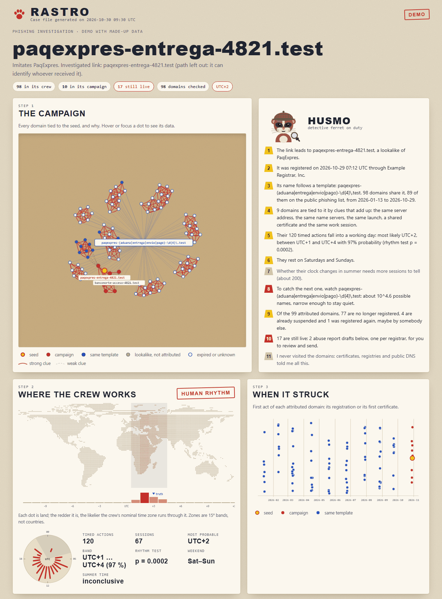

# Rastro

[](https://github.com/Ruby570bocadito/rastro/actions/workflows/tests.yml)
[](LICENSE)

**Paste a phishing link. Watch the whole campaign unfold.**

> Status: pre-alpha. The validation experiments are done, and the first end-to-end command, `rastro investigate`, works on real data. Expect rough edges.

Rastro turns one phishing URL into the campaign behind it, estimates which time zone its operators work in, and watches Certificate Transparency to catch the campaign's next domain before its first victim. Husmo, a detective ferret, explains every deduction and how sure it is.



Try it offline with a made-up case, in a few seconds:

```bash
pip install -e .
```

```bash
rastro demo --open
```

The demo's brands do not exist, its domains end in `.test` (reserved, so nobody can register one), its addresses come from the ranges reserved for documentation, and its crew is simulated at UTC+3, Monday to Friday. The case file marks that truth under the map, so you can check Rastro's answer against it. `--lang es` writes it in Spanish.

## Validation experiments

| # | Question | Status |
|---|----------|--------|
| 01 | Do lookalike domains show a human working rhythm in the hour of their first certificate? | First run inconclusive: crt.sh alone gives too few domains. See [experiments](experiments/README.md) |
| 01b | The same test on brand groups from a public phishing list | Apple: no rhythm, since years of different crews cancel out. Replaced by 01c |
| 01c | The rhythm test on families that share a naming template, counted by work session | 3 of 4 families show a human working day even after correcting for multiple tests (Coinbase family: UTC−9 to UTC−5). The map stays, with "inconclusive" when the test fails. See [experiments](experiments/README.md) |
| 02 | Does one URL expand to at least 10 sibling domains with the free urlscan quota plus crt.sh? | pending |
| 03 | After 10 domains of a family, does a learned naming pattern catch the rest without matching others? | Narrow patterns catch a median 87 % with no outside matches. See [experiments](experiments/README.md) |
| 04 | How often would those patterns fire on fresh, real certificates? | Narrow patterns: 0 of 30,720. Broad ones: about 6,600 false alarms a day. See [experiments](experiments/README.md) |
| 06 | How much data do the calendar clues need, and what do they say about the real families? | Weekend: reliable from about 50 sessions spread over 8 weeks or more. DST: weak, needs hundreds. Holidays: never enough here. The Coinbase and Amazon crews work all seven days. See [experiments](experiments/README.md) |
| 05 | Do the template families break into campaigns once certificates, timing and infrastructure are added? | The WhatsApp family is one 68-domain launch. Coinbase comes in waves. Infrastructure matters for fresh domains, not old ones. See [experiments](experiments/README.md) |
| live | Does one link unfold end to end? | A Coinbase lookalike caught live by the watcher, and missing from the public list, unfolded into a crew of 95 domains. Only it is still live, and the crew clock is UTC−7 again, now with registrations as a second clock. See [experiments](experiments/README.md) |

## Run it

Python 3.11 or newer, no dependencies for the core.

```bash
pip install -e .
```

### Investigate a link

```bash
rastro investigate "hxxps://lookalike-domain[.]example/path" --lang es
```

Paste the link as it came, defanged or not. Rastro:

1. finds lookalikes built like it (same brand and template, or the same unusual word) in a public phishing list (`--list`, by default `data/raw/lists/phishing-domains-ACTIVE.txt` when present), in what the watcher stored (`--db`), and among the names that shared a certificate with it;
2. looks each one up: first certificate (crt.sh), registration and registrar (RDAP), addresses and name servers (public DNS over HTTPS);
3. separates the **crew** (every domain built from the seed's narrow template, possibly over years) from the **campaign** (the domains joined to the seed by clues that add up);
4. estimates the crew's time zone from its registrations and first certificates, and says "inconclusive" when the rhythm test fails;
5. gives the pattern that catches the next domain, ready for `rastro watch`;
6. drafts one abuse report per registrar for the domains still registered, and says why the others stay out (expired, already suspended, held by a brand-protection registrar, or registered again by somebody else).

Husmo tells the result in the terminal, and the whole case lands in one HTML file (`data/raw/reports/<domain>.html` by default), with the graph, the map, the timeline, the pattern and the drafts. The case file:

- carries its data, styles and script inline, with a Content-Security-Policy that forbids every network request, so opening it contacts nobody;
- never contains the path of the link, which often carries a token that identifies whoever received it;
- writes every attacker-controlled string as text, never as HTML.

Rastro never connects to the domains and never sends the drafts: you read them, complete them and send them yourself. `--json FILE` saves the case data, `--offline` uses cached answers only, and `--no-crtsh`, `--no-rdap` and `--no-dns` skip a source.

Learn the naming pattern of a campaign from a file of domains, one per line:

```bash
rastro pattern domains.txt
```

Estimate which time zone a crew works in from UTC times (ISO 8601) or hours, one per line:

```bash
rastro rhythm times.txt
```

With full dates and times it also tests three calendar clues: the daylight-saving regime (European, US, southern or none), the weekend in local time (Saturday-Sunday, Friday-Saturday, Sunday only or none), and gaps on holidays (Christmas, Orthodox Christmas, Chinese New Year, Eid al-Fitr). Each clue answers "inconclusive" below the amount of data experiment 06 found it needs.

Watch fresh certificates straight from a Certificate Transparency log, alert on the next domain of a campaign, and spot campaigns being born:

```bash
rastro watch --learn campaign-domains.txt --follow --minutes 60 --db data/ct.sqlite --alerts alerts.jsonl --bursts-every 10
```

- It only arms narrow patterns (at most 10^9 possible names) and says which ones it skips; `--allow-broad` overrides.
- The brands' official domains never alert, and `--allow FILE` adds your own.
- Each domain alerts once, although its pre-certificate and certificate both reach the log.
- With `--db` it resumes where it stopped and keeps only the certificates that carry a brand lookalike or raised an alert, about 0.2 to 0.4 % of the log (tens of MB a day instead of about 6 GB). It counts everything it read per hour, so it knows how much it covered. `--store-all` keeps every certificate.
- `--bursts-every` looks, with no seed at all, for several new lookalikes of one brand built from the same template, and prints the pattern ready to arm.
- `--follow` keeps up with the log in real time; Let's Encrypt's log moves about 400 KB/s.
- Without `--follow` it reads the latest `--tiles` tiles and stops.
- `rastro logs` lists the current logs, which rotate every six months.

Look for campaigns being born among the names already stored:

```bash
rastro bursts --db data/ct.sqlite --hours 24
```

Group domains into campaigns, from a list or from what the watcher stored:

```bash
rastro campaigns --domains suspicious.txt --dns
```

```bash
rastro campaigns --db data/ct.sqlite --hours 72 --dns
```

Clues add up per pair of domains, and pairs that reach 1.0 join the same campaign:

| Clue | Weight |
|---|---|
| shared certificate | 1.0 |
| the same long, unusual word around the brand | 1.0 |
| same template | 0.5 |
| same work session (30 minutes) | 0.5 |
| same launch (each domain within 72 hours of the previous one) | 0.5 |
| same address or name servers | weighted by how rare they are |

A template alone never joins two domains. `--dns` asks Cloudflare's public DNS-over-HTTPS resolver, so Rastro never connects to the domains themselves.

Run the experiments and the tests:

```bash
python -I experiments/exp01b_lista.py --census
```

```bash
python -m pytest
```

## Layout

- `src/rastro/investigate.py`: from one link to its crew, campaign, clock, next domain and abuse report drafts.
- `src/rastro/husmo.py`: Husmo's words for an investigation, in English and Spanish.
- `src/rastro/demo.py`: the made-up world behind `rastro demo`.
- `src/rastro/report.py` and `assets/report.html`: the self-contained HTML case file.
- `src/rastro/sources/rdap.py`: registrations and registrars' abuse desks through RDAP, never personal contacts.
- `src/rastro/rhythm.py`: time-zone model. It scores the 24 nominal UTC offsets against a typical working day, allows for bots and for crews that start earlier or later, and tests the hours against round-the-clock activity.
- `src/rastro/watch.py`: the live watcher (narrow patterns only, official-domain allowlist, one alert per domain, resume).
- `src/rastro/bursts.py`: spots campaigns being born among stored names.
- `src/rastro/campaigns.py`: groups domains into campaigns from clues that add up.
- `src/rastro/sources/dns.py`: addresses and name servers through a public DNS-over-HTTPS resolver, cached.
- `src/rastro/brands.py`: imitated brands, their official domains, and what a throwaway lookalike looks like.
- `src/rastro/sources/ctlog.py` and `der.py`: read tiled CT logs directly, with no dependencies.
- `src/rastro/store.py`: SQLite store of the names seen and of where each watch stopped.
- `src/rastro/calendar_clues.py`: daylight saving, weekend and holiday clues for the map, with the bars below which they stay silent.
- `src/rastro/__main__.py`: the `rastro` command line.
- `src/rastro/pattern.py`: learns a readable regular expression from a campaign's domains and reports how many names it could match.
- `src/rastro/sources/crtsh.py`: crt.sh client with retries and an on-disk cache.
- `experiments/`: validation experiments and their aggregated results.
- `tests/`: unit tests on synthetic data.
- `scripts/landmask.py`: how the map's land dots were made.

## What Rastro will not do

- Identify people. It stops at time zones and infrastructure.
- Touch attacker infrastructure or use credentials found in phishing kits.
- Publish scans of URLs that contain victim data.

## Security

To report a vulnerability in Rastro itself, see [SECURITY.md](SECURITY.md).

## License

[Apache-2.0](LICENSE). Copyright 2026 Ruby570bocadito.

The map's land outline comes from [Natural Earth](https://www.naturalearthdata.com/) (public domain), through the world-atlas package.
